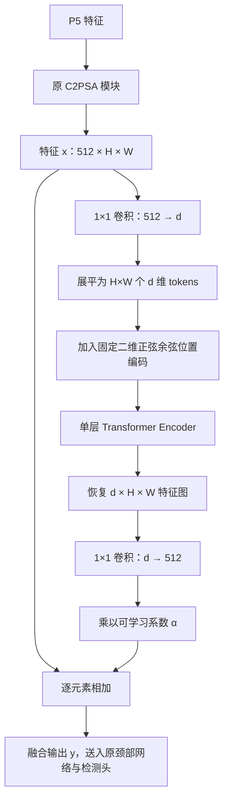

# YOLO26s 与 ViT 的历史 v3 实验

此文保留旧版实验的原始命令和目录名。当前训练入口与文件位置见[仓库首页](../../README.md)。

## 项目简介

本项目在 YOLO26s 的 P5 特征上增加 ViT 门控残差分支，用于无人车与无人艇目标检测。通过基线、不同分支容量和不同初始化方式的对照实验，研究这些设计对检测效果的影响。

仓库包含四种模型实现，以及本地数据加载、单模型训练、多模型与多随机种子实验、检查点评估和结果汇总工具。训练数据采用 Roboflow Driverless Vehicle 第 3 版。

后续训练统一使用项目内的 `Driverless Vehicle.yolo26/data.yaml`。2026-11-19 清理后，仅保留本次完成 100 轮的 baseline 结果及对应记录；旧数据集缓存、其他实验产物、闲置环境和安装缓存已移入 Windows 回收站。当前环境 `.venv-cuda`、四模型源码、Roboflow 数据、初始权重及测试源码均保留。

阅读导航：[项目简介](#项目简介) · [模型架构与融合方法](#模型架构与融合方法) · [快速开始](#快速开始) · [模型训练与对照实验](#模型训练与对照实验) · [数据集](#数据集) · [评估与结果](#评估与结果) · [项目结构与其他说明](#项目结构与其他说明)

## 模型架构与融合方法

### P5 门控残差融合

融合位置位于 YOLO26s 的 P5 高层特征处。原 C2PSA 模块保留，其输出同时进入残差直连和新增 ViT 分支，融合结果继续送入原有颈部网络和检测头。

下图展示 P5 局部结构：



融合公式为：

$$
y = x + \alpha F_{\mathrm{ViT}}(x)
$$

其中，`x` 是 C2PSA 输出，`d` 是 ViT 分支的隐藏维度。输入投影将 512 通道映射到 `d` 维，每个空间位置对应一个 token；二维正弦余弦位置编码保留其空间信息。单层 Transformer Encoder 使用多头自注意力和 MLP 处理这些 tokens，再通过输出投影恢复为 512 通道，与 `x` 相加。

`α` 是可学习的标量，初值为 0，使融合层初始输出与原 P5 特征一致，训练中用于调整新增分支的贡献。640×640 输入对应 20×20 的 P5 特征，即 400 个 tokens。

### 四种模型的区别

| 模型（`--model`） | 融合操作 | 初始化与比较目的 |
|---|---|---|
| `baseline` | 使用原 YOLO26s 结构 | COCO 权重初始化，作为对照 |
| `p5_vit_small` | P5 增加单层编码器，256 维、4 头 | 新分支随机初始化，考察较小分支 |
| `p5_vit_random` | P5 增加单层编码器，768 维、12 头 | 新分支随机初始化，与 small 比较容量 |
| `p5_vit_pretrained` | 与 random 使用相同结构 | 迁移 ImageNet ViT-B/16 第一个编码块，与 random 比较初始化 |

四种模型均从 YOLO26s COCO 权重迁移原检测网络中形状兼容的参数；检测头按 UGV/USV 两类重建，形状不匹配的参数随机初始化。三个融合分支的 MLP 扩展比均为 4，门控系数均从 0 开始学习。

预训练版使用 Torchvision 的 `ViT_B_16_Weights.IMAGENET1K_V1`，仅迁移首个编码块 `encoder.layers.encoder_layer_0` 的 LayerNorm、自注意力和 MLP 参数。其余编码块、patch embedding、预训练位置编码、class token 和分类头均不迁移；输入、输出投影仍随机初始化，位置编码使用本项目的固定二维编码。相同 seed 下，它与 random 的结构、投影初始化和门控初值一致，区别在于编码块的初始权重。实现见 [fusion/models.py](../support/fusion/models.py)。

## 快速开始

以下命令使用 **Windows PowerShell、Python 3.12**。默认在编号为 `0` 的 NVIDIA GPU 上训练。

### 1. 克隆项目并安装依赖

```powershell
git clone https://github.com/Britney-codemax/yolo26-vit-driverless-vehicle.git
Set-Location yolo26-vit-driverless-vehicle

py -3.12 -m venv .venv-cuda
.\.venv-cuda\Scripts\python.exe -m pip install torch==2.13.0 torchvision==0.28.0 --index-url https://download.pytorch.org/whl/cu126
.\.venv-cuda\Scripts\python.exe -m pip install -r requirements-cuda.txt
.\.venv-cuda\Scripts\python.exe -m pip check
```

项目固定使用 PyTorch 2.13.0、Torchvision 0.28.0、Ultralytics 8.4.14 和 aiohttp 3.14.5。`requirements-cuda.txt` 引用 `requirements.txt`，并额外固定本次使用的 CUDA 12.6 依赖版本，两份清单均需保留。环境必须独立，不能使用 `--system-site-packages`；启动时会拒绝系统包继承、用户包注入和从环境外加载的核心包。

本机项目位于 `D:\yolo26-vit`，已有 `.venv-cuda`、数据和初始权重，可直接使用后面的检查与训练命令，无需重装或重新下载。`.venv-cuda` 依赖系统 Python `D:\python3.12`，请保留该目录；也可在此环境中用 `--device cpu` 执行结构检查。

### 2. 下载并放好数据

从 [Roboflow Driverless Vehicle 第 3 版](https://universe.roboflow.com/yans-workspace-47kt2/driverless-vehicle-iv6qt/dataset/3) 下载 **YOLO26 格式**数据包，解压到项目根目录下的 `Driverless Vehicle.yolo26/`，确认包含 `data.yaml`、`train/` 和 `valid/`。类别与详细统计见后文[数据集](#数据集)。

### 3. 设置路径并检查结构

在同一个 PowerShell 窗口、项目根目录下执行：

```powershell
$data = ".\Driverless Vehicle.yolo26\data.yaml"
.\.venv-cuda\Scripts\python.exe run_experiments.py --data "$data" --check --device cpu
```

检查会输出数据统计和四种模型的结构信息，完成后退出；此步骤不加载初始权重或启动训练。

### 4. 下载初始权重

```powershell
.\.venv-cuda\Scripts\python.exe train.py --download-weights all
```

YOLO26s 和 ViT-B/16 官方权重保存到 `artifacts/weights/`，供后续四种模型使用。已有本地权重可通过 `--weights "路径"` 和 `--vit-weights "路径"` 指定。

### 5. 开始训练 baseline

本次 baseline 已续训完成 100 轮，最佳权重来自第 78 轮；验证集 mAP50=76.89%，mAP50–95=60.04%。结果见 [实验记录](EXPERIMENTS.md)，当前训练说明见 [故障处理说明](TRAINING_DIAGNOSTICS.md)。完成一次续训不代表所有 CUDA 长训故障已消除。以下命令用于新实验。

```powershell
.\run_gpu_compat.cmd --models baseline
```

该入口设置总计 100 轮、`patience=0`（关闭早停），结果保存在 `artifacts/runs/roboflow_v3/batch_<时间戳>/baseline_seed0/`。训练及最终评估成功后自动写入 `metrics.json`；本次已完成的 baseline 无需重跑。后续三模型的命令见下文。

## 模型训练与对照实验

以下命令均在项目根目录执行。新开 PowerShell 窗口后，先设置数据路径：

```powershell
$data = ".\Driverless Vehicle.yolo26\data.yaml"
```

### 单模型训练

四种模型共用 `train.py`。本机 100 轮实验统一从 `run_gpu_compat.cmd` 启动，通过 `--models` 选择；脚本依次调用 `run_experiments.py` 和 `train.py`：

```powershell
# 原 YOLO26s 基线
.\run_gpu_compat.cmd --models baseline

# 小容量 ViT 分支
.\run_gpu_compat.cmd --models p5_vit_small

# 宽 ViT 分支，随机初始化
.\run_gpu_compat.cmd --models p5_vit_random

# 宽 ViT 分支，迁移预训练编码块
.\run_gpu_compat.cmd --models p5_vit_pretrained
```

直接调用 `train.py --model ...` 仍可用于单模型实验，默认目录为 `<模型名>_seed<种子>_<时间戳>/`。但配置文件默认 `patience=40`，且直接调用不会自动设置兼容入口的后端环境变量；需要统一 100 轮设置时使用上面的启动脚本。

### 中断后续训

今后有未完成运行的 `weights/last.pt` 时，可用以下入口继续到原定总轮次。将 `$checkpoint` 替换为实际中断运行的路径；本次已完成的运行不需要续训：

```powershell
$checkpoint = ".\artifacts\runs\roboflow_v3\未完成运行的目录\weights\last.pt"
.\run_gpu_resume.cmd "$checkpoint" --check
# 上一行仅检查，不训练。确认记录后，去掉 --check 才开始续训：
.\run_gpu_resume.cmd "$checkpoint"
```

入口保持 `.venv-cuda`、关闭 cuDNN 和同步报错，按检查点恢复模型种类、原总轮数、优化器及 EMA。拒绝数据、环境或显式训练参数变化；不需要重新提供初始权重。自动创建新的运行目录，复制已有 results.csv、last.pt 和历史 best.pt，原始失败目录保留。失败不会自动重试，完成后仍生成 metrics.json；全程由本地进程执行，无需助手轮询。

这解决中断后重复从头训练的问题，不代表 CUDA 根因已修复。恢复采用 Ultralytics 原生方式，从保存的 EMA 和优化器状态继续，不恢复完整随机状态或未完成 epoch；续训轮次写入记录和协议分组，不与无中断训练混为同一实验条件。

### 短程诊断

先使用独立验收入口检查真实数据转换、原生 baseline 对照、全负样本、正负混合、多目标和不足 batch 的情况。它会执行真实优化器更新，并检查四模型保存与重载：

```powershell
$env:YOLO_DISABLE_CUDNN = "1"  # 与当前 GPU 兼容入口使用相同后端
.\.venv-cuda\Scripts\python.exe checks\verify_training.py --data "$data" --device 0
```

随后按顺序对四种模型各运行最多 200 个训练 batch；任一失败立即停止后续任务：

```powershell
foreach ($model in @("baseline", "p5_vit_small", "p5_vit_random", "p5_vit_pretrained")) {
    .\.venv-cuda\Scripts\python.exe train.py --model "$model" --data "$data" --device 0 --diagnose-batches 200
    if ($LASTEXITCODE -ne 0) { throw "$model 诊断失败，请检查刚生成的诊断目录。" }
}
```

`--diagnose-batches N` 仅用于 `train.py`，N 为正整数；不能与 `--check` 或权重下载同时使用。它保留原训练参数与学习率日程，在进程初始化前开启 CUDA 同步报错，使用真实数据和优化器；达到 N 批后退出，即使进度条仍显示 `/100` 也不会继续跑满 100 轮。若提前达到轮数或早停上限而不足 N 批，诊断记为失败。

诊断产物位于 `artifacts/diagnostics/`。`run.json` 的 `diagnostic_passed` 表示短程通过，并记录完成 batch 数与优化器更新次数；诊断不要求 `best.pt`，不参与 `compare.py` 正式汇总。独立验收的四模型结果分别保存在 `acceptance.json`，首个失败后的模型保持 `not_run`。

异常时保存 `console.log`、`failure_batch.pt` 和 `failure_batch.json`（若已读取 batch）。快照含送入 GPU 前的增强后 CPU 输入、图片路径及 batch 序号；GPU 故障后不再读取 GPU 张量。它没有捕获故障瞬间的模型权重和完整随机状态；用最近的 `last.pt` 或初始权重复验属于近似回放。loss 或梯度出现 NaN/Inf 时也立即终止。诊断会增加同步开销，短程通过不等于长时间稳定性已验证。

正式训练、短程诊断与独立评估都记录验证阶段故障：`failure_batch.json` 保存阶段、epoch、batch、图片、输入形状、计算 dtype 和进入该 batch 前的显存统计；`failure_traceback.txt` 保留完整异常链，向外报告最初的异常。验证故障快照不会被上一批训练数据覆盖。没有读到当前输入的初始化或汇总错误只保存异常记录，不冒充某张图片导致的问题。

可以在单独进程中重复轮末验证，读取历史权重而不更新权重：

```powershell
$env:YOLO_DISABLE_CUDNN = "1"
.\.venv-cuda\Scripts\python.exe checks\verify_validation.py --data "$data" --weights "<已有的 last.pt 路径>" --device 0 --batch 4 --repeats 20
```

`--batch` 支持 4、8；baseline 可加 `--native` 对照相同权重的原生模型。此检查包含轮末 loss 与全部验证图片，结果保存在 `artifacts/diagnostics/validation_replay_<时间戳>/acceptance.json`。它不包含此前几十轮的训练过程，不等同于复现了原故障。

### 四模型串行实验

按 baseline、small、random、pretrained 的顺序运行，默认使用 seed=0：

```powershell
.\run_gpu_compat.cmd
```

每次调用创建一个 `batch_<时间戳>/` 目录，各模型结果保存在其中的 `<模型名>_seed0/` 子目录。任一模型失败后立即停止批次，打印失败模型、已完成轮数和日志位置，剩余任务保持未运行。

当前 baseline 已完成，接下来只训练其余三种模型可执行：

```powershell
.\run_gpu_compat.cmd --models p5_vit_small p5_vit_random p5_vit_pretrained
```

这会新增三个模型的运行目录，不会覆盖已有 baseline。当前 baseline 在第 53 轮后续训过，续训经历会参与协议分组；后续无中断结果不能强行归入同一实验协议。

### GPU 兼容启动（长程稳定性待验证）

正式长训使用以下入口：显式调用独立 `.venv-cuda`，关闭 cuDNN、启用同步报错，设置 100 轮、训练与轮末验证 batch 均为 4、关闭早停。该设置已用于本次完成的 baseline 续训，其他模型的 100 轮稳定性仍需实际验收：

```powershell
.\run_gpu_compat.cmd --models baseline
```

去掉 `--models baseline` 可依次训练四种模型。入口设置 `YOLO_DISABLE_CUDNN=1` 和 `CUDA_LAUNCH_BLOCKING=1`，可能降低速度；环境变量只作用于本次启动及其子进程。后端选择和实际轮末验证 batch 写入运行记录及协议标识，不能与旧协议结果直接合并。同步报错用于定位故障，不是修复保证。该入口不重试失败任务、不跳过 batch。

### 多随机种子比较

四种模型分别使用 0、1、2 三个种子，共串行运行 12 次训练：

```powershell
.\run_gpu_compat.cmd --seeds 0 1 2
```

若只比较基线与随机初始化宽分支，可在命令后加 `--models baseline p5_vit_random`。完成后运行 `compare.py`，查看同一实验条件下的均值、标准差和相对基线的差值。

### 默认训练参数

| 参数 | 默认值 |
|---|---|
| 输入尺寸 `imgsz` | 640 |
| 批大小 `batch` | 4 |
| 最大轮数 `epochs` | 100 |
| 早停耐心值 `patience` | 配置文件为 40；`run_gpu_compat.cmd` 覆盖为 0，关闭早停 |
| 优化器 | AdamW |
| 初始学习率 `lr0` | 0.001 |
| 混合精度 `amp` | false（关闭） |
| 随机种子 `seed` | 0 |
| 设备 `device` | 0 |

完整配置见 [configs/train.yaml](../configs/train.yaml)。`--epochs`、`--batch`、`--imgsz`、`--device` 等参数可在命令行覆盖；学习率通过配置文件调整。当前入口固定使用 AdamW 和关闭 AMP。对照实验应使用相同的数据、训练设置和 seed 集合。

## 数据集

数据来源：[Driverless Vehicle v3](https://universe.roboflow.com/yans-workspace-47kt2/driverless-vehicle-iv6qt/dataset/3)，[Roboflow 项目入口](https://app.roboflow.com/yans-workspace-47kt2/driverless-vehicle-iv6qt/3)。

工作区为 `yans-workspace-47kt2`，项目为 `driverless-vehicle-iv6qt`。以下统计对应 2026-11-18 导出的 YOLO26 数据包，导出文件标注的许可为 CC BY 4.0。

| 集合 | 图片数 | 标注框数 | 负样本图片数 |
|---|---:|---:|---:|
| 训练集 train | 769 | 707 | 137 |
| 验证集 valid | 168 | 111 | 75 |
| 合计 | 937 | 818 | 212 |

类别编号为 **`0 = UGV`（无人车）、`1 = USV`（无人艇）**。按维护者确认，212 张负样本为外观相近的有人驾驶船、车，其中 119 张为本次新增；它们以空 `.txt` 标签参与训练，不新增类别，用于学习目标与相似背景的区别。

解压后的目录结构如下，图片和标签按文件名配对：

```text
Driverless Vehicle.yolo26/
├── data.yaml
├── README.dataset.txt
├── README.roboflow.txt
├── train/
│   ├── images/
│   └── labels/
└── valid/
    ├── images/
    └── labels/
```

当前数据包提供 train 和 valid；配置中的 `val` 对应 `valid/` 目录。本文使用验证集评估，无独立 test 集，来源分组与视觉近重复尚未核验。

## 评估与结果

### 每个模型的指标放在哪里

目前只保留 baseline 的完成结果，其余三模型尚无可报告的完整结果。以下为 2026-11-19 清理后的状态；后续新增结果以 [实验记录](EXPERIMENTS.md) 的自动汇总为准。

| 模型 | 当前状态 | 验证集 mAP50 | 验证集 mAP50–95 |
|---|---|---:|---:|
| `baseline` | 100 轮完成，第 78 轮为最佳权重 | 76.89% | 60.04% |
| `p5_vit_small` | 暂无完整结果 | — | — |
| `p5_vit_random` | 暂无完整结果 | — | — |
| `p5_vit_pretrained` | 暂无完整结果 | — | — |

**本次 baseline 的最终指标文件：**

```text
D:\yolo26-vit\artifacts\runs\roboflow_v3\baseline_seed0_20261119_141852_696039\metrics.json
```

本地查看：[最终指标 metrics.json](../artifacts/runs/roboflow_v3/baseline_seed0_20261119_141852_696039/metrics.json) · [100 轮 results.csv](../artifacts/runs/roboflow_v3/baseline_seed0_20261119_141852_696039/results.csv) · [完整运行目录](../artifacts/runs/roboflow_v3/baseline_seed0_20261119_141852_696039/)。这些产物不提交 Git，链接需要在保留训练结果的本机查看。

今后通过 `run_gpu_compat.cmd` 或 `run_experiments.py` 启动时，每次新建一个批次目录。以 seed=0 为例：

```text
artifacts/runs/roboflow_v3/batch_<时间戳>/
├── plan.json                       # 本批模型、种子、目录与执行状态
├── baseline_seed0/metrics.json
├── p5_vit_small_seed0/metrics.json
├── p5_vit_random_seed0/metrics.json
└── p5_vit_pretrained_seed0/metrics.json
```

上图为位置示意，实际只创建所选且已经启动的模型目录。直接运行 `train.py` 或使用续训入口时，默认位于 `artifacts/runs/roboflow_v3/<模型名>_seed<种子>_<时间戳>/`；每次启动的具体位置以控制台和汇总报告为准。

| 单次运行内的文件 | 用途与读取方式 |
|---|---|
| `metrics.json` | 训练及最终评估成功后生成：`overall.map50`、`overall.map50_95` 为整体指标，`per_class.UGV` / `per_class.USV` 为分类指标；数值为 0–1，乘 100 得百分比 |
| `results.csv` | 每轮训练损失与验证指标；用于看收敛过程，最后一行不是最佳权重的最终评估结果 |
| `weights/best.pt` | 按验证集 mAP50–95 选择的最佳检查点，`metrics.json` 对应该文件 |
| `weights/last.pt` | 最后一轮检查点；未完成训练可用续训入口恢复 |
| `run.json` | 模型名、seed、状态、已跑轮数、最佳轮数、环境、数据与代码指纹，以及续训来源 |
| `args.yaml`、`effective_args.json` | 本次实际训练参数 |
| `console.log` | 本次进程的训练与验证输出、错误信息 |

**训练未完成或最终评估失败时，可能没有 `metrics.json`。** 先检查 `run.json` 的 `status`、`completed_epochs` 与 `console.log`，不能把指标缺失当作 0，也不能只凭已有 `results.csv` 判定训练成功。最终指标使用重载的 `best.pt` 评估，可能与逐轮 CSV 略有差异，应以 `metrics.json` 为准。现有分数来自 valid 验证集，不是独立测试集。

无需重新训练或评估即可读取当前 baseline 指标：

```powershell
$run = ".\artifacts\runs\roboflow_v3\baseline_seed0_20261119_141852_696039"
$metrics = Get-Content -LiteralPath "$run\metrics.json" -Raw | ConvertFrom-Json
$metrics.overall
$metrics.per_class
```

### 评估检查点

在项目根目录执行，将 `RUN_ID` 替换为实际单模型运行目录名（如 `baseline_seed0_<时间戳>`）：

```powershell
$data = ".\Driverless Vehicle.yolo26\data.yaml"
$weights = ".\artifacts\runs\roboflow_v3\RUN_ID\weights\best.pt"
.\.venv-cuda\Scripts\python.exe evaluate.py --weights "$weights" --data "$data" --split val --device 0
```

批量实验的权重位于 `artifacts/runs/roboflow_v3/batch_<时间戳>/<模型名>_seed<种子>/weights/best.pt`，将 `$weights` 改为该路径即可。

训练过程按验证集 mAP50-95 选择 `best.pt`，结束后自动重载该检查点进行评估。上述命令可单独评估已有检查点，输出整体及每个类别的 Precision、Recall、mAP50 和 mAP50-95，记录保存到 `artifacts/evaluations/roboflow_v3/`。

### 汇总实验

```powershell
.\.venv-cuda\Scripts\python.exe compare.py
```

`compare.py` 读取已保存的训练与独立评估记录，更新 [docs/EXPERIMENTS.md](EXPERIMENTS.md)，并生成汇总文件；它不启动训练或推理。正式训练流程也会尝试自动刷新汇总；需要重新生成报告时执行上面的命令即可，原始指标仍保存在各运行目录中。

| 位置 | 内容 |
|---|---|
| `docs/EXPERIMENTS.md` | 四模型运行状态、整体和分类指标、同协议分组统计；未完成结果不补零 |
| `artifacts/runs/roboflow_v3/` | 每次运行的 `metrics.json`、`results.csv`、日志、实际参数、`weights/best.pt` 和 `weights/last.pt` |
| `artifacts/evaluations/roboflow_v3/` | 独立检查点评估记录 |
| `artifacts/reports/summary.json` | 实验明细与分组统计 |
| `artifacts/reports/runs.csv` | 便于进一步分析的结果表 |

## 项目结构与其他说明

```text
.
├── train.py                 # 单模型训练、数据检查、权重下载
├── run_experiments.py       # 多模型与多种子串行实验
├── evaluate.py              # 检查点评估
├── compare.py               # 实验汇总
├── run_gpu_compat.cmd       # 当前环境下的 100 轮训练入口
├── run_gpu_resume.cmd       # 未完成运行的断点续训入口
├── fusion/                  # 融合模型、数据接口、训练器与记录逻辑
├── configs/                 # 模型和训练配置
├── tests/                   # 离线验收
├── checks/                  # 显式执行的真实数据 CPU/GPU 验收
├── docs/                    # 实验记录与故障处理说明
├── .venv-cuda/              # 当前独立环境，本地保留，不提交 Git
├── Driverless Vehicle.yolo26/ # 当前 Roboflow 原始数据
├── artifacts/
│   ├── datasets/            # 当前数据的转换缓存
│   ├── weights/             # 官方初始权重
│   ├── runs/roboflow_v3/    # 各模型训练结果
│   ├── reports/             # 汇总结果与清理核验记录
│   ├── config/              # 本地运行配置与字体
│   └── cache/               # 运行时按需重建的小缓存
├── requirements.txt
├── requirements-cuda.txt    # 引用 requirements.txt 的 CUDA 依赖清单
└── LICENSE
```

### 测试与实验状态

```powershell
.\.venv-cuda\Scripts\python.exe -m unittest discover -s tests -v
```

测试覆盖数据加载、正负样本、融合结构、训练器重建、评估、汇总、诊断控制和中断续训。诊断测试在 CPU 上执行小尺寸合成数据的真实优化器更新；GPU 验收通过上面的独立入口显式启动。现存正式结果只有本次完成 100 轮的 baseline；当前说明见 [故障处理说明](TRAINING_DIAGNOSTICS.md)，结果见 [实验记录](EXPERIMENTS.md)。

<details>
<summary>数据缓存与实验记录细节</summary>

- 数据入口支持本地 YOLO `.yaml/.yml` 和检测 NDJSON；YOLO 图片目录可命名为 `images/` 或 `imgs/`。加载器沿用原划分和类别顺序，兼容本次导出中的相对路径；每个集合对应一个本地图片目录，YOLO 输入不执行 YAML 下载脚本。
- 空标签是合法负样本，缺失标签、非法标注、损坏图片、孤立标签和跨集合完全相同的图片文件会报错。缺少独立 test 集时，`--split test` 会报错。
- 训练和评估将数据整理到 `artifacts/datasets/` 的短文件名缓存中，原始数据保持不变。首次准备会增加一份图片缓存；数据内容变化后使用新缓存，移动整个数据包不改变数据指纹。
- YAML 数据指纹涵盖类别、来源元数据、划分、相对文件名及图片和标签内容。`--check` 只检查数据与结构，不建立图片缓存、下载或加载初始权重。
- 官方初始权重分别为 `artifacts/weights/yolo26s.pt` 和 `artifacts/weights/vit_b_16_imagenet1k_v1.pth`；缺少文件时使用上方下载命令准备。
- 各运行目录保存原始日志、实际配置、权重和数据指纹。`--run-dir` 可指定其他产物目录，默认汇总范围为 `roboflow_v3` 下的运行；2026-11-19 已按要求清除其他历史运行。
- 数据、代码、环境或训练条件不同的实验分别统计。同模型、同协议的不同 seed 用于计算均值与样本标准差；同一 seed 的重复完成记录全部排除，单 seed 标准差记为 N/A。先单跑再批量运行相同条件和 seed 会产生重复记录；基线与候选的有效 seed 集合一致时才计算差值。固定 seed 不保证不同 GPU 环境逐位复现。
- 报告使用同一 `best.pt` 检查点的整组指标。训练后先重载检查点并设置 `eval()`，再通过 `val()` 计算指标；P/R 对应最大平均 F1 工作点。
- 原有合成集成测试禁止外部网络和优化器更新；新增诊断测试在 CPU 上验证真实更新。缺少官方权重时，真实权重检查会明确跳过，原有加载路径测试可使用标记为合成的检查点。

</details>

### 许可证与参考

代码采用 **AGPL-3.0**，详见 [LICENSE](../../LICENSE)。数据许可见 Roboflow 来源页面及下载包中的说明，预训练权重遵循各自来源许可。数据、权重、环境和运行产物由 `.gitignore` 排除。

上游主要参考为 Ultralytics 8.4.14，融合逻辑位于本仓库，安装包源文件保持原样。

- [Ultralytics YOLO26](https://docs.ultralytics.com/models/yolo26/)
- [Ultralytics 许可说明](https://www.ultralytics.com/license)
- [Torchvision ViT-B/16](https://docs.pytorch.org/vision/stable/models/generated/torchvision.models.vit_b_16.html)

提交问题时请附上运行命令、环境信息和日志，并移除访问令牌、邀请链接及带签名的下载地址。
